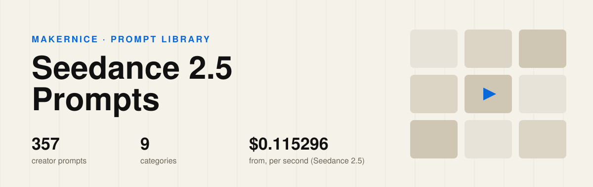

<p align="center"></p>

<h1 align="center">Awesome Seedance 2.5 Prompts</h1>

<p align="center"><b>357 Seedance 2.5 and 2.0 video prompts, hand-picked from creators on X</b> — not scraped. Every clip was watched and every prompt checked against the creator's own post,<br>each one credited and one click away from a rerun on Makernice with the price shown first.</p>

<p align="center">
<a href="#-browse-by-category"></a>
<a href="#-browse-by-category"></a>

<a href="https://makernice.com/models/seedance-2-5/?utm_source=github&utm_medium=prompts-repo&utm_campaign=awesome-seedance-2.5-prompts"></a>
<a href="#%EF%B8%8F-license--reuse"></a>
</p>

<p align="center"><b><a href="https://makernice.com/prompts/seedance-2-5/?utm_source=github&utm_medium=prompts-repo&utm_campaign=awesome-seedance-2.5-prompts">▶ Watch the clips with sound on Makernice</a></b> · <a href="https://github.com/makernice/awesome-minimax-h3-prompts">MiniMax H3 prompts</a> · <a href="https://github.com/makernice/awesome-wan-kling-prompts">Wan & Kling prompts</a></p>

## Contents

- [🗂️ Browse by category](#%EF%B8%8F-browse-by-category)
- [⭐ Featured](#-featured)
- [🔥 Most liked](#-most-liked)
- [🎬 Seedance 2.5 at a glance](#-seedance-25-at-a-glance)
- [💡 What these prompts teach](#-what-these-prompts-teach)
- [▶️ Run these prompts](#%EF%B8%8F-run-these-prompts)
- [✅ Why this list](#-why-this-list)
- [📊 Statistics](#-statistics)
- [🤝 How to contribute](#-how-to-contribute)
- [©️ Copyright & takedown notice](#%EF%B8%8F-copyright--takedown-notice)
- [⚖️ License & reuse](#%EF%B8%8F-license--reuse)
- [🙏 Acknowledgements](#-acknowledgements)
- [👤 Maintainer](#-maintainer)

## 🗂️ Browse by category

<table>
<tr><td width="33%" valign="top" align="center"><a href="prompts/vlog-daily-life.md"></a><br><b>📱 <a href="prompts/vlog-daily-life.md">Vlog &amp; Daily Life</a></b><br><sub>67 prompts</sub></td><td width="33%" valign="top" align="center"><a href="prompts/fantasy-surreal.md"></a><br><b>🪐 <a href="prompts/fantasy-surreal.md">Fantasy &amp; Surreal</a></b><br><sub>57 prompts</sub></td><td width="33%" valign="top" align="center"><a href="prompts/action.md"></a><br><b>💥 <a href="prompts/action.md">Action &amp; Martial Arts</a></b><br><sub>56 prompts</sub></td></tr>
<tr><td width="33%" valign="top" align="center"><a href="prompts/3d-cartoon.md"></a><br><b>🧸 <a href="prompts/3d-cartoon.md">3D &amp; Cartoon</a></b><br><sub>50 prompts</sub></td><td width="33%" valign="top" align="center"><a href="prompts/cinematic-drama.md"></a><br><b>🎭 <a href="prompts/cinematic-drama.md">Cinematic &amp; Drama</a></b><br><sub>48 prompts</sub></td><td width="33%" valign="top" align="center"><a href="prompts/product-ads.md"></a><br><b>🛍️ <a href="prompts/product-ads.md">Product (UGC &amp; Ads)</a></b><br><sub>31 prompts</sub></td></tr>
<tr><td width="33%" valign="top" align="center"><a href="prompts/travel-nature.md"></a><br><b>🏔️ <a href="prompts/travel-nature.md">Travel &amp; Nature</a></b><br><sub>21 prompts</sub></td><td width="33%" valign="top" align="center"><a href="prompts/fashion-dance.md"></a><br><b>👗 <a href="prompts/fashion-dance.md">Fashion &amp; Dance</a></b><br><sub>18 prompts</sub></td><td width="33%" valign="top" align="center"><a href="prompts/anime.md"></a><br><b>🌸 <a href="prompts/anime.md">Anime</a></b><br><sub>9 prompts</sub></td></tr>
</table>

## ⭐ Featured

<table>
<tr><td width="33%" valign="top" align="center"><a href="prompts/vlog-daily-life.md#p-2079189509586260101"></a><br><b><a href="prompts/vlog-daily-life.md#p-2079189509586260101">Casual Phone Footage of a Beach Day With Friends</a></b><br><sub>15 s · 16:9 · <a href="https://x.com/Goodmanprotocol/status/2079189509586260101">@Goodmanprotocol</a></sub></td><td width="33%" valign="top" align="center"><a href="prompts/action.md#p-2113841913065615450"></a><br><b><a href="prompts/action.md#p-2113841913065615450">Subway Revenge Slap Scene</a></b><br><sub>30 s · 16:9 · <a href="https://x.com/AIwithkhan/status/2113841913065615450">@AIwithkhan</a></sub></td><td width="33%" valign="top" align="center"><a href="prompts/cinematic-drama.md#p-2094997895187673489"></a><br><b><a href="prompts/cinematic-drama.md#p-2094997895187673489">Early-2000s MiniDV Home Video Reunion</a></b><br><sub>30 s · 16:9 · <a href="https://x.com/AIwithkhan/status/2094997895187673489">@AIwithkhan</a></sub></td></tr>
<tr><td width="33%" valign="top" align="center"><a href="prompts/3d-cartoon.md#p-2105256819623129130"></a><br><b><a href="prompts/3d-cartoon.md#p-2105256819623129130">Furry Beaver Creature and Gorilla Friend in a Meadow</a></b><br><sub>53 s · 16:9 · <a href="https://x.com/Zarnab_with_Ai/status/2105256819623129130">@Zarnab_with_Ai</a></sub></td><td width="33%" valign="top" align="center"><a href="prompts/travel-nature.md#p-2113594768400023908"></a><br><b><a href="prompts/travel-nature.md#p-2113594768400023908">Open-Door Helicopter Ride Over Tokyo</a></b><br><sub>30 s · 16:9 · <a href="https://x.com/Just_sharon7/status/2113594768400023908">@Just_sharon7</a></sub></td><td width="33%" valign="top" align="center"><a href="prompts/anime.md#p-2104106520808157221"></a><br><b><a href="prompts/anime.md#p-2104106520808157221">Tiny Doodle Skateboarder Rides Across an Office Desk</a></b><br><sub>30 s · 16:9 · <a href="https://x.com/harboriis/status/2104106520808157221">@harboriis</a></sub></td></tr>
</table>

## 🔥 Most liked

Likes on the original X post, read on 2026-11-06.

| # | | Prompt | Category | Length | Creator | ♥ on X |
|---|---|---|---|---|---|---|
| 1 |  | [Subway Station Revenge Fight](prompts/action.md#p-2108760866422415701) | Action & Martial Arts | 30 s | [@AIwithSynthia](https://x.com/AIwithSynthia/status/2108760866422415701) | 10,010 |
| 2 |  | [Documentary-Style Summer Day of a Young Man](prompts/vlog-daily-life.md#p-2091396663718117706) | Vlog & Daily Life | 27 s | [@Sheldon056](https://x.com/Sheldon056/status/2091396663718117706) | 7,037 |
| 3 |  | [Japanese Anime Katsudon Cooking Sequence](prompts/product-ads.md#p-2098845134326808734) | Product (UGC & Ads) | 30 s | [@Goodmanprotocol](https://x.com/Goodmanprotocol/status/2098845134326808734) | 4,916 |
| 4 |  | [Indonesian Neighborhood Morning Walk Vlog](prompts/vlog-daily-life.md#p-2089204108175741157) | Vlog & Daily Life | 10 s | [@RishuaVR](https://x.com/RishuaVR/status/2089204108175741157) | 4,723 |
| 5 |  | [Sunday Afternoon in an Older Seoul Neighborhood](prompts/vlog-daily-life.md#p-2096424933366931946) | Vlog & Daily Life | 30 s | [@AIwithkhan](https://x.com/AIwithkhan/status/2096424933366931946) | 4,141 |
| 6 |  | [Husky Meets Wild Animals in Snowy Mountains](prompts/3d-cartoon.md#p-2110654938472952253) | 3D & Cartoon | 81 s | [@RizwanAly07](https://x.com/RizwanAly07/status/2110654938472952253) | 3,912 |
| 7 |  | [Frozen Time and Rewind in a 1950s Diner](prompts/cinematic-drama.md#p-2083389002552664385) | Cinematic & Drama | 30 s | [@techhalla](https://x.com/techhalla/status/2083389002552664385) | 2,865 |
| 8 |  | [Simple Day in an Older Seoul Neighborhood](prompts/vlog-daily-life.md#p-2105860239375638663) | Vlog & Daily Life | 30 s | [@AIwithkhan](https://x.com/AIwithkhan/status/2105860239375638663) | 2,855 |
| 9 |  | [Lab Containment Breach Sci-Fi Horror Short](prompts/fantasy-surreal.md#p-2099725768310009982) | Fantasy & Surreal | 30 s | [@auqibhabib](https://x.com/auqibhabib/status/2099725768310009982) | 2,408 |
| 10 |  | [Otter Pilots a Giant Mech Against a Marble Octopus](prompts/anime.md#p-2021412306291392535) | Anime | 15 s | [@emollick](https://x.com/emollick/status/2021412306291392535) | 2,212 |

## 🎬 Seedance 2.5 at a glance

| Model on Makernice (price list v12) | Length per run | Price per second | Modes | Aspect ratios |
|---|---|---|---|---|
| Seedance 2.5 | 4–30 s | 480p $0.115296 · 720p $0.2592 · 1080p $0.64152 · 4K $1.955 | Text-to-video · Image-to-video · First and last frame · up to 16 reference images | adaptive, 16:9, 9:16, 1:1, 4:3, 3:4, 21:9, 9:21 |
| Seedance 2.0 | 4–15 s | 720p $0.1704 · 1080p $0.42528 | Text-to-video · Image-to-video · First and last frame · up to 9 reference images | 21:9, 16:9, 4:3, 1:1, 3:4, 9:16 |
| Seedance 2.0 Fast | 4–15 s | 720p $0.10272 | Text-to-video · Image-to-video · First and last frame · up to 9 reference images | 21:9, 16:9, 4:3, 1:1, 3:4, 9:16 |

Failed, timed-out or canceled-while-queued runs release the hold in full.

## 💡 What these prompts teach

- **Long clips are written in parts.** 148 of the 357 split the clip into numbered shots, scenes or time codes.
- **Name the camera.** 336 of the 357 say how the camera moves or where it sits.
- **Write the sound.** 167 of the 357 describe what you should hear.
- **Length is not quality.** These run from 280 to 16,149 characters.

## ▶️ Run these prompts

Every entry links to Makernice, where you can rerun it by API. Entries that are live on the site open the creator's clip, a shot-by-shot breakdown and a one-click rerun. From code, quote first (free, locked for 12 minutes), then create with the quote:

```bash
curl -s https://api.makernice.com/v1/generations/quote \
  -H "Authorization: Bearer $MAKERNICE_API_KEY" \
  -H "Content-Type: application/json" \
  -d '{"model":"seedance-2.5","mode":"t2v","duration":10,"resolution":"720p","aspect_ratio":"16:9","prompt":"..."}'
```

## ✅ Why this list

**Hand-picked, not bulk-scraped.** Many prompt lists are collected by scripts. Every entry here was chosen by a person who watched the clip, from posts that drew strong saves and shares on X.

**Checked against the creator's own post.** Every prompt is copied from the creator's post or their own reply in the same thread, then read against the original. Prompts guessed from the video alone are not accepted.

**One click to rerun, price first.** Every entry opens on Makernice, where you can rerun it by API. The price is quoted before you pay, and failed runs are not charged.

## 📊 Statistics

| Metric | Value |
|---|---|
| Prompts in this repository | 357 |
| Unique creators | 103 |
| Categories | 9 |
| Multi-shot or time-coded prompts | 148 |
| Originals that use reference images | 64 |
| Median prompt length | 2,262 characters |
| Last updated | 2026-11-06 |

## 🤝 How to contribute

Found a Seedance 2.5 and 2.0 prompt that belongs here? Open an issue with the link to the creator's post. It goes through the same checks as every other entry: the creator's own text, real engagement and the content rules. This README and every page under `prompts/` are generated from `data/`; please do not edit them by hand.

## ©️ Copyright & takedown notice

This repository carries three kinds of material under three different terms.

**Code** (generator scripts and tooling) is released under the MIT License; see the `LICENSE` file. The MIT License covers the code only.

**Curation** (selection, organization, statistics and the summaries written by us) is licensed under [CC BY 4.0](https://creativecommons.org/licenses/by/4.0/). Reuse it with attribution to *Makernice*.

**Prompts and media** remain the copyright of their original creators. Prompt text, thumbnails and video links are quoted from publicly published posts for reference; every entry links back to its original post. Nothing here grants a license to the underlying prompt or media beyond what the original post allows.

**Takedown process.** If you are a rights holder and want an entry removed or corrected, open a GitHub issue with the entry's link and the original post, or email support@makernice.com. Requests are checked against the original post and handled within 3 business days; the entry is removed from `data/` and disappears from every generated file on the next update. Earlier commits in the Git history may still contain it.

## ⚖️ License & reuse

Code in this repository is open source under the MIT License: use it, modify it, build on it, keep the license notice. Curation is CC BY 4.0; prompts and media stay with their creators. Details above under [Copyright & takedown notice](#%EF%B8%8F-copyright--takedown-notice).

## 🙏 Acknowledgements

- **The creators** credited on every entry, for publishing their prompts in the open.
- [LearnPrompt/awesome-seedance](https://github.com/LearnPrompt/awesome-seedance) — source-checked entries, statistics and the three-term copyright notice.
- [ai-boost/awesome-image-video-prompts](https://github.com/ai-boost/awesome-image-video-prompts) — one data file per entry, folded prompts and category pages generated from data.
- [freestylefly/awesome-gpt-image-2](https://github.com/freestylefly/awesome-gpt-image-2) — category cover cards.

## 👤 Maintainer

Maintained by the Makernice Team · [Makernice](https://makernice.com/?utm_source=github&utm_medium=prompts-repo&utm_campaign=awesome-seedance-2.5-prompts) · support@makernice.com
